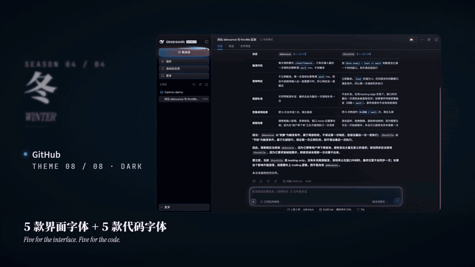
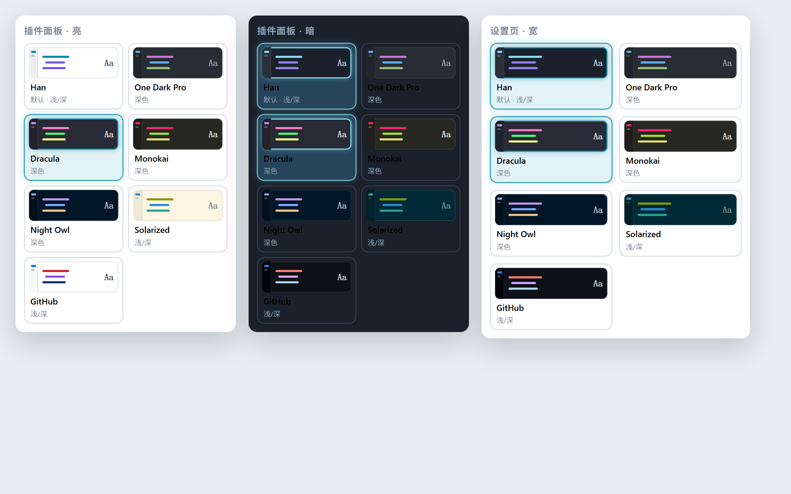

# Hanmo 翰墨

An appearance plugin for the [DeepSeek Harness](https://www.npmjs.com/package/@deepseek-ai/dsh) (DSH) Web UI.

[中文说明](./README.zh-CN.md)



Full 33-second film: [hanmo-daynight.mp4](https://github.com/xiaonerner0821/dsh-hanmo/releases/download/v1.4.0/hanmo-daynight.mp4)



## Features

- **Sidebar**: each nav row is an outlined tile with a soft cyan glow. One selection shape per list slides between rows on a spring. New Session carries a comet trace.
- **Main panel**: a glass composer, a stats chip and a separate context-meter chip.
- **Colour themes**: Han (the default look), **DeepSeek Harness**, One Dark Pro, Dracula, Monokai, Night Owl, Solarized, GitHub, **深海 (Deep Sea)** (looking down into the water: cyan to deep blue, sunlight breaking into shafts at the surface, bubbles rising from below), **沙滩 (Beach)** (clear sky, turquoise sea, a line of surf, warm sand — the foam is noise-built, so no two stretches match), **朝阳 (Sunrise)** (the mirror of Sunset: the sun at the top, warm first light cooling down to clear morning blue; dark is the blue hour, its dawn glow reaching the farthest corner of the window) and **落日 (Sunset)**, whose sidebar is one continuous sunset sky from zenith to horizon (golden hour in light, dusk in dark). The **Gradient sky** switches in the appearance popover and Settings > General put a sky on the sidebar and / or the main panel for every theme; other themes paint theirs from their own palette, cool zenith through rose to a warm horizon. A **wallpaper** of your own can be set in the same places: main panel only, or across the whole window, with a veil slider that keeps text readable. Each theme recolours the UI, the sidebar, code highlighting and the comet. Themes are also registered with DSH's own theme service, so they appear in **Settings > General** as well.
  **DeepSeek Harness** is the unthemed look: DSH exactly as it appears without this plugin. It lifts every skin and override (sidebar tiles, dark palette, fonts, sizes, weights, text colour, panel opacity) and leaves the appearance button, the Settings row and the file preview tab in place, so you can switch back.
- **Appearance popover** in the session header: theme, light/dark/system, UI and code fonts, font sizes, body text weight and code weight, body text colour (remembered per theme) and panel opacity. **Reset** returns everything to Han.
- **File preview tab** next to Conversation / Trajectory, with Shiki highlighting, a sticky tab bar and a diff toolbar. Opening a diff opens the right panel without closing a sidebar that is already open.
- **Offline**: no CDN requests. The Latin subsets of Inter and Geist Mono are embedded; Chinese text uses locally installed fonts.

## Requirements

- DSH `0.2.1-rc.x` with the Web UI (`dsh web`). Tested on `0.2.1-rc.5`.
- A Chromium-based browser (Chrome, Edge). The styles use `color-mix()` and `backdrop-filter`.

## Install

From npm, in DSH: open **Settings > Plugins** and install the package `@xiaonerner0821/dsh-hanmo`, or ask the agent to install that bundle. Refresh the page afterwards.

From a local checkout:

```sh
git clone https://github.com/xiaonerner0821/dsh-hanmo.git
```

Then install the bundle from the local path (the installation spec is `link:<absolute path to the checkout>`). Edits to `client.js` take effect on the next page refresh; there is no build step.

To confirm it loaded, run this in the browser console. It prints the plugin version:

```js
document.querySelector('[data-hanmo]').dataset.hanmo
```

## Optional fonts

Themes list their preferred fonts first and fall back to what is installed, so nothing breaks without them. For the intended look, install:

| Theme | Fonts |
| --- | --- |
| Han | HarmonyOS Sans SC |
| One Dark Pro, Dracula | Fira Code |
| Night Owl | Victor Mono (Operator Mono is also listed, if you own a licence) |
| Solarized | Source Code Pro |
| GitHub | Mona Sans, Monaspace Neon |

Restart the browser after installing a font so it is picked up.

## Known limits

- Hanmo styles DSH's Web UI from the outside. A few selectors match DSH's generated class names (for example `JObwrW_root` on the context meter), so a DSH update can break part of the look until the plugin is updated. File an issue with your DSH version if something looks wrong.
- DSH only persists its built-in light/dark/system preference. At page load it paints that scheme first, so a colour theme can flash for one frame before it is applied.
- While an Hanmo theme is active, DSH's own Light / Dark / System buttons in Settings show no selection. Use the plugin's popover or its row in Settings.
- The themes exist only while the plugin is enabled. Disabling it returns DSH to its built-in scheme.
- **DeepSeek Harness** restores DSH's look, not a pristine profile: the appearance button, the Settings row and the file preview tab stay visible. To remove those too, disable the plugin.
- **DeepSeek Harness** clears the font families and sizes it can reach. Setting files the font choice to `''` makes DSH use its own built-in stack; if you had set a custom family in DSH's Settings yourself, that value is overwritten.

## Development

```sh
npm run check        # syntax check of client.js and index.js
npm run build:fonts  # re-embed the Inter / Geist Mono subsets (downloads from unpkg)
```

`client.js` is a single plain-JavaScript module loaded by DSH's client module loader. It uses React through `React.createElement` and DSH's slot, theme and conversation services.

## Licence

MIT, see [LICENSE](./LICENSE). Credits for adapted code, colour themes and embedded fonts are in [THIRD_PARTY_NOTICES.md](./THIRD_PARTY_NOTICES.md).
