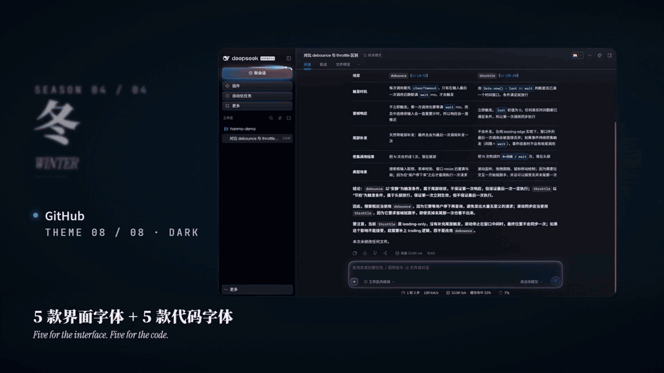
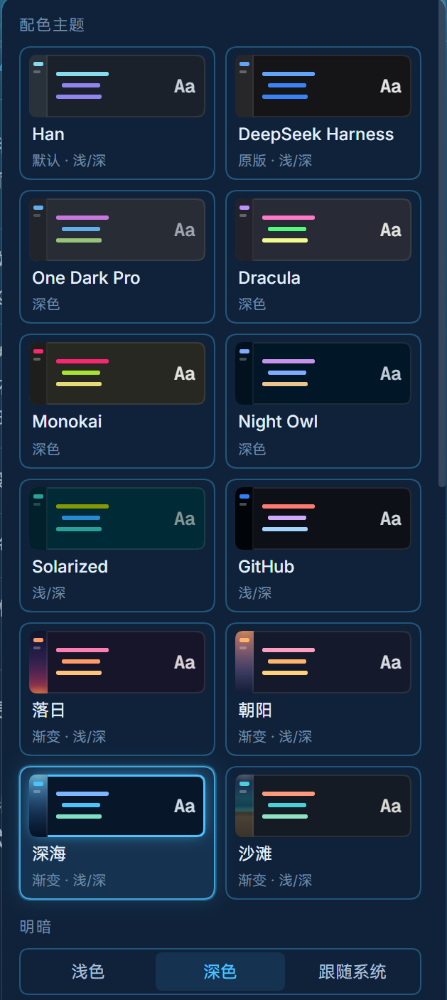

# 翰墨 Hanmo

[DeepSeek Harness](https://www.npmjs.com/package/@deepseek-ai/dsh)（DSH）Web 界面的外观插件。

[English](./README.md)



完整宣传片（36 秒）：[hanmo-daynight.mp4](https://github.com/xiaonerner0821/dsh-hanmo/releases/download/v1.4.0/hanmo-daynight.mp4)



## 功能

- **侧边栏**：每个导航行都是带青色微光的描边卡片；每个列表只有一个选中框，切换时随弹簧在行间滑动；「新会话」按钮带彗星光效。
- **主面板**：玻璃质感输入框、统计胶囊，以及单独的上下文用量胶囊。
- **配色主题**：Han（默认外观）、**DeepSeek Harness**、One Dark Pro、Dracula、Monokai、Night Owl、Solarized、GitHub，**深海**（从水面往下看：青色到深蓝的海水，阳光在水面散开成光柱，气泡从深处升起）、**沙滩**（晴空、碧海、一道浪花线、暖色沙滩，浪花由噪声生成，每段都不一样）、以及 **朝阳**（与落日相对：太阳在顶部，天空从暖色晨光往下过渡到清晨的晴空蓝；深色为日出前的蓝调时刻，晨光从太阳一直铺到页面最远的角落）和 **落日**（侧边栏是一整片从天顶到地平线连续渐变的日落天空，浅色为黄金时刻、深色为暮色）。外观面板与「设置 > 通用」里的 **渐变天空** 可以把这片天空分别铺到侧边栏和主面板，所有主题都支持：其他主题会用自己的配色画一片从冷色天顶、经玫瑰色到暖色地平线的天空。外观面板和「设置 > 通用」里还可以选 **壁纸**：用你自己的图片做背景，可选只覆盖主面板或同时覆盖侧边栏和主面板，并可调遮罩浓度让文字保持清晰。主题会同时改变界面、侧边栏、代码高亮和彗星颜色，并注册进 DSH 自己的主题服务，所以在 **设置 > 通用** 里也能选。
  **DeepSeek Harness** 就是未安装插件时的原版外观：撤掉本插件全部样式与覆盖（侧边栏卡片、深色配色、字体、字号、字重、正文颜色、面板不透明度），只留外观按钮、设置页那一行和文件预览标签页，方便随时切回来。
- **外观面板**（会话标题栏）：主题、浅色/深色/跟随系统、界面与代码字体、字号、正文与代码字重、正文颜色（每个主题分别记住）、面板不透明度。「恢复默认」会一并回到 Han。
- **文件预览标签页**：位于「对话」「轨迹」旁边，Shiki 语法高亮、吸顶标签栏、diff 工具栏。点击 diff 会打开右侧面板，但不会关掉已经打开的侧边栏。
- **离线可用**：不请求任何 CDN。内嵌 Inter 与 Geist Mono 的拉丁字符子集，中文使用本机已安装的字体。

## 环境要求

- 带 Web 界面（`dsh web`）的 DSH `0.2.1-rc.x`，已在 `0.2.1-rc.5` 上测试。
- Chromium 内核浏览器（Chrome、Edge）。样式用到了 `color-mix()` 和 `backdrop-filter`。

## 安装

从 npm 安装：在 DSH 里打开 **设置 > 插件**，安装 `@xiaonerner0821/dsh-hanmo`；也可以直接让智能体安装这个 bundle。装好后刷新页面。

从本地源码安装：

```sh
git clone https://github.com/xiaonerner0821/dsh-hanmo.git
```

然后按本地路径安装 bundle（安装规格为 `link:<仓库的绝对路径>`）。修改 `client.js` 后刷新页面即生效，不需要构建。

确认是否加载成功：在浏览器控制台执行下面这行，会输出插件版本号。

```js
document.querySelector('[data-hanmo]').dataset.hanmo
```

## 可选字体

主题会把推荐字体放在字体栈最前面，没装就自动用下一个，不影响使用。想要完整效果可以安装：

| 主题 | 字体 |
| --- | --- |
| Han | HarmonyOS Sans SC |
| One Dark Pro、Dracula | Fira Code |
| Night Owl | Victor Mono（有授权的话也可装 Operator Mono，字体栈里已列出） |
| Solarized | Source Code Pro |
| GitHub | Mona Sans、Monaspace Neon |

装完字体后需要重启浏览器才能识别。

## 已知局限

- 翰墨是从外部给 DSH 界面改样式。少数选择器匹配的是 DSH 生成的类名（例如上下文用量胶囊上的 `JObwrW_root`），DSH 升级后可能有局部样式失效，需要插件跟进。遇到问题请提 issue 并注明 DSH 版本。
- DSH 只会持久保存它自带的浅色/深色/跟随系统设置。页面加载时会先画出这个配色，所以主题可能闪一帧再生效。
- 启用翰墨主题时，DSH 设置里自带的「浅色 / 深色 / 跟随系统」按钮不会显示选中状态。请用插件的外观面板，或设置页里插件那一行。
- 主题只在插件启用期间存在。停用插件后 DSH 回到自带配色。
- **DeepSeek Harness** 还原的是外观，不是全新的配置：外观按钮、设置页那一行、文件预览标签页仍然存在。连这些也要去掉，请停用插件。
- **DeepSeek Harness** 会清空它能触及的字体与字号设置：把字体写成空值，让 DSH 用它自带的字体栈；如果你曾在 DSH 设置里自己指定过字体，那个值会被覆盖。

## 开发

```sh
npm run check        # 检查 client.js 与 index.js 语法
npm run build:fonts  # 重新内嵌 Inter / Geist Mono 子集（会从 unpkg 下载）
```

`client.js` 是一个纯 JavaScript 模块，由 DSH 的客户端模块加载器载入，通过 `React.createElement` 使用 React，并调用 DSH 的插槽、主题与会话服务。

## 许可证

MIT，见 [LICENSE](./LICENSE)。借鉴的代码、配色主题和内嵌字体的出处与许可见 [THIRD_PARTY_NOTICES.md](./THIRD_PARTY_NOTICES.md)。
